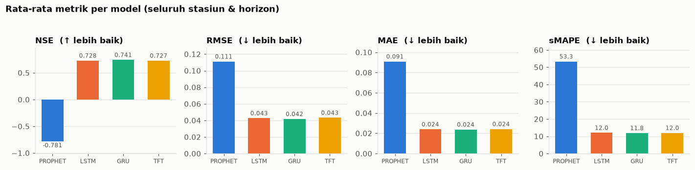
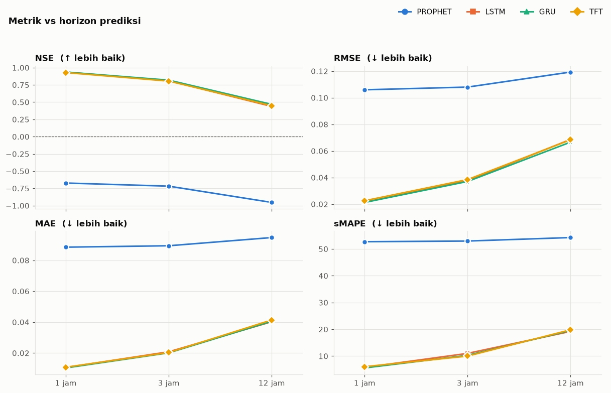
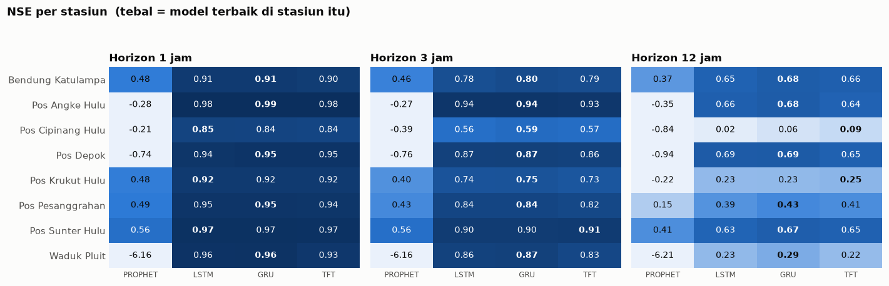
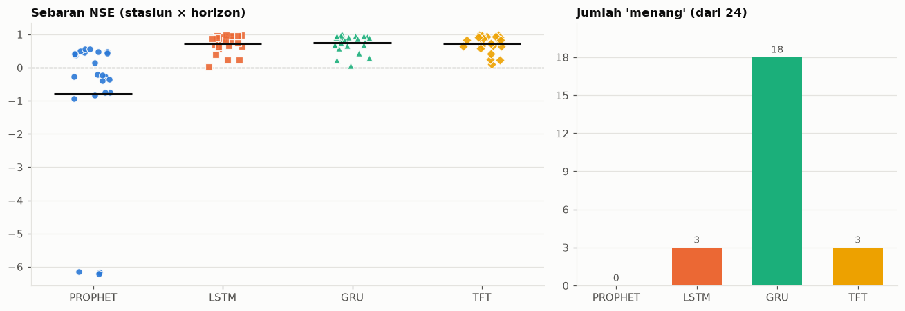

# Flood Forecasting Pipeline

End-to-end forecast serving for river water-level stations. Given a model
already trained and selected as "best" (Prophet, LSTM, GRU, or TFT — weights
and selection results already live in BigQuery), this pipeline pulls the
freshest raw sensor data, preprocesses it the same way the training data was
prepared, runs inference, and returns the forecast in real units (cm).

The training code itself lives in the Colab notebooks under
[`notebooks_training/`](notebooks_training/) — the four candidate models don't
need retraining, so only the serving path (preprocessing + inference) is
packaged as the `src/` pipeline. How the candidates compared is summarised in
[Training results](#training-results).

## Project layout

```
.
├── main.py                  # production entrypoint (runs the forecast pipeline)
├── pyproject.toml / uv.lock # dependencies
├── config/
│   ├── raw_preprocessing.yaml # API endpoint + BigQuery table names used by src/raw_preprocessing
│   ├── rainfall.yaml        # Open-Meteo model, grid bounding box + table name used by src/rainfall
│   ├── preprocessing.yaml   # BigQuery project/dataset/table names used by src/preprocessing
│   └── prediction.yaml      # BigQuery project/dataset/table names + lookback/horizons used by src/prediction
├── queries/                 # every BigQuery SQL statement, as .sql files (common/, prediction/)
├── notebooks_training/      # Colab notebooks: preprocessing check, model training (01-04), selection (05), training report (06)
├── docs/
│   ├── architecture.md      # module-level call flow, pure vs. I/O boundaries
│   └── images/              # figures embedded in this README (exported from notebook 06)
├── tests/                   # unit tests for pure logic (no BigQuery access)
└── src/
    ├── settings.py          # loads a module's YAML from config/ (+ GCP_PROJECT/BQ_DATASET/BQ_LOCATION overrides)
    ├── query_loader.py      # reads queries/*.sql, validates + fills table/column identifiers
    ├── bq.py                # shared BigQuery helpers: client factory, run_query, naive datetime index
    ├── logging_setup.py     # logging config for the CLIs (JSON with severity on Cloud Run)
    ├── raw_preprocessing/   # API crawl -> station_features_{hourly,daily} (water level + calendar features)
    ├── rainfall/            # Open-Meteo -> rainfall_hourly (rain per grid cell) + per-station cell ranking
    ├── preprocessing/       # one-time setup: station_features -> train/val/test, scalers, metadata
    ├── prediction/          # forecast pipeline: best model + latest data -> forecast (cm)
    ├── load_best_model.py   # CLI: inspect/load the current best model's weights
    └── predict.py           # CLI: run the full forecast pipeline
```

## Setup

Requires [uv](https://docs.astral.sh/uv/) and Python 3.10–3.12 (uv will fetch
a matching interpreter automatically if you don't have one).

```
uv sync
```

This creates `.venv/` with every dependency pinned exactly as resolved in
`uv.lock` — no manual environment setup needed on a new machine.

### Google Cloud credentials

The pipeline talks to BigQuery directly (`google.cloud.bigquery`), so it
needs credentials in the environment it runs in — Application Default
Credentials:

```
gcloud auth application-default login
```

or, in a deployed/production environment, a service account key via
`GOOGLE_APPLICATION_CREDENTIALS`. (`authenticate()` in `preprocessing` is a
no-op outside Google Colab — it only handles the Colab-specific auth flow.)

## Configuration

`config/raw_preprocessing.yaml`, `config/rainfall.yaml`,
`config/preprocessing.yaml` and
`config/prediction.yaml` each declare their own `project`, `dataset`,
`location`, and the BigQuery table names they read or write. They're separate files because preprocessing and prediction are
independently runnable — pointing either one at a different project/dataset
(e.g. a staging environment) doesn't require touching the other.

### Environment variables

| Variable | Effect |
| --- | --- |
| `GCP_PROJECT`, `BQ_DATASET`, `BQ_LOCATION` | Override `project` / `dataset` / `location` in every `config/*.yaml`, e.g. to point a run at a staging dataset without editing files. |
| `SIBANJIR_TOKEN` | API token for `raw_preprocessing` (see `.env.example`). |
| `LOG_LEVEL` | `DEBUG` / `INFO` (default) / `WARNING` / `ERROR`. |
| `LOG_FORMAT` | `json` or `text`. Defaults to `json` on Cloud Run (so Cloud Logging picks up `severity`), `text` elsewhere. |

### SQL queries

All BigQuery SQL lives in [`queries/`](queries/) as `.sql` files, not as
strings in Python. Values (`@station`, `@horizon`, `@since`) are query
parameters; optional filters are written as `@x IS NULL OR col = @x` so each
file is one fixed statement. Only table and column names, which BigQuery can't
parameterize, are substituted into `{table}` / `{columns}` — by
`src/query_loader.py`, which rejects anything that isn't a plain
`project.dataset.table` / column name. To change a query, edit the `.sql`
file; to add one, drop a file in and call `bq.run_query(client, "folder/name", table=...)`.

## Usage

Run the full forecast pipeline (latest data → forecast, in cm):

```
uv run python main.py
uv run python main.py --station "Bendung Katulampa" --horizon 1 3
uv run python main.py --write-bq        # also persist to tables.forecast_output
uv run python main.py --csv forecast.csv
```

Inspect which model is currently "best" and load its weights without running
a forecast (useful for debugging):

```
uv run python src/load_best_model.py
uv run python src/load_best_model.py --station "Bendung Katulampa" --horizon 3
```

Build `station_features_hourly` or `station_features_daily` from the
sisteminformasibanjir API (crawls one request per day, so a full history
takes a while). `granularity` in `config/raw_preprocessing.yaml` picks the
default (`hourly` = the hourly grid, `daily` = daily max per station);
`--granularity` overrides it per run. The API token is read
from the `SIBANJIR_TOKEN` env var — put it in `.env` (copy `.env.example`)
and the Makefile passes it through:

```
make raw-preprocess                               # -> artifacts/station_features_hourly.parquet
make raw-preprocess ARGS="--granularity daily"    # -> artifacts/station_features_daily.parquet
make raw-preprocess ARGS="--end 2026-08-25"
make raw-preprocess-bq                            # also writes tables.station_features_<granularity> (WRITE_TRUNCATE)
```

Hourly rainfall comes from Open-Meteo's Historical Forecast API (ECMWF IFS,
~9 km grid, no API key). Instead of exact station coordinates, every model
grid cell inside the upstream bounding box in `config/rainfall.yaml` is
fetched (one `rain_<lat>_<lon>` column per cell); hours that haven't happened
yet are dropped, since the API also returns forecasts.

The free API quota is weighted (locations × 2-week blocks; 600/min,
5,000/h, 10,000/day), so requests are throttled automatically, and the full
history of all ~81 cells (~12k) wouldn't fit in a day. Hence three steps:
survey every cell over one wet season inside the train period, rank cells
per station by lagged correlation between rain and water-level rise (train
period only, writes `artifacts/rainfall_cell_ranking.csv`), then fetch the
full history only for the top `TOP` cells per station (~15 min in total). If
the quota still runs out, or on Ctrl+C, completed chunks are saved —
continue with `rainfall-incremental`.

```
make rainfall-survey         # 1. all cells, survey season -> artifacts/rainfall_survey.parquet
make rainfall-rank           # 2. needs artifacts/station_features_hourly.parquet too
make rainfall-bq TOP=3       # 3. full history, top 3 cells per station -> tables.rainfall_hourly
make rainfall-incremental    # routine: re-fetch last days, merge, rewrite table
```

Then preprocess that table for modelling. `granularity` in
`config/preprocessing.yaml` picks which table set is read and written
(`station_features_<g>` -> `preprocessed_data_<g>`,
`preprocessing_metadata_<g>`, `preprocessing_scalers_<g>`):

```
make preprocess                                   # uses granularity from config
make preprocess ARGS="--granularity daily"
```

With `rainfall.enabled` (hourly only), `make preprocess` also needs
`tables.rainfall_hourly` and `artifacts/rainfall_cell_ranking.csv`, so run the
rainfall steps above first. This is the only preprocessing path — notebook
`00_Preprocessing` now just inspects the result.

None of these touch the unsuffixed tables (`station_features`,
`preprocessing_metadata`, `preprocessing_scalers`) that hold the older hourly
models. `config/prediction.yaml` sets the `granularity` that `prediction`
serves (currently `hourly`) and the matching table set; `lookback`/`horizons`
for each granularity live under `model:` in the same file. Run `make help` for
every target.

### Scheduled updates (Cloud Run Job)

The Cloud Run Job `flood-hourly` in `asia-southeast2` (Jakarta) runs
[`deploy/hourly_job.sh`](deploy/hourly_job.sh) every hour at minute 15 WIB,
triggered by Cloud Scheduler: raw preprocessing incremental, rainfall
incremental, and — when the job's env var `RUN_PREDICT` is `true` —
`predict --write-bq`. It has to run from an Indonesian region: the
sisteminformasibanjir API drops requests from IPs outside Indonesia (GitHub
Actions runners and `us-central1` time out).

One-time setup (and redeploy after code changes), from the repo root after
`gcloud auth login`, with `SIBANJIR_TOKEN` in `.env` and the initial backfills
already in BigQuery:

```
bash deploy/setup_cloud_run.sh
gcloud run jobs execute flood-hourly --region asia-southeast2 --project thesis-506605 --wait
```

Run the test suite (unit tests only, no BigQuery access needed; the same
command runs in CI on every push and pull request):

```
uv run pytest
```

Diagnostics go through `logging` (configured by each CLI, see `LOG_LEVEL` /
`LOG_FORMAT` above). Only command results — the forecast table from
`predict.py`, the ranking from `rainfall.analysis` — are printed to stdout.
When calling `run()` from a notebook, call
`logging_setup.configure_logging()` first to see progress output.

## Training results

Comparison of the four candidates across 8 stations × 3 horizons (1, 3, 12 h
ahead), read from `gds_datasource.model_comparation_metric_hourly` (the table
behind the Looker Studio dashboard). The full report, with every plot and the
complete per-station table, is
[`notebooks_training/06_Training_Report.ipynb`](notebooks_training/06_Training_Report.ipynb).

NSE: higher is better, 1 is perfect, 0 is no better than predicting the mean,
below 0 is worse than that. RMSE / MAE / sMAPE: lower is better. RMSE and MAE
are computed on the MinMax-scaled water level (0–1), not in cm.

| Model | Mean NSE | Median NSE | RMSE | MAE | sMAPE (%) | Best in (of 24) |
| --- | ---: | ---: | ---: | ---: | ---: | ---: |
| Prophet | -0.781 | -0.218 | 0.1111 | 0.0909 | 53.3 | 0 |
| LSTM | 0.728 | 0.842 | 0.0426 | 0.0239 | 12.0 | 3 |
| **GRU** | **0.741** | 0.841 | **0.0417** | **0.0237** | **11.8** | **18** |
| TFT | 0.727 | 0.825 | 0.0432 | 0.0242 | 12.0 | 3 |

Mean NSE by horizon:

| Model | 1 h | 3 h | 12 h |
| --- | ---: | ---: | ---: |
| Prophet | -0.673 | -0.718 | -0.954 |
| LSTM | 0.935 | 0.810 | 0.438 |
| GRU | 0.936 | 0.819 | 0.467 |
| TFT | 0.928 | 0.804 | 0.448 |

What the numbers say:

- **GRU is the best by a small margin.** LSTM, GRU and TFT are within about
  0.015 mean NSE of each other, so the choice between them is not decisive;
  GRU does win the most station × horizon combinations (18 of 24).
- **Prophet is far behind** — its NSE is negative at half the stations
  (Pos Angke Hulu, Pos Cipinang Hulu, Pos Depok, Waduk Pluit), and about -6 at
  Waduk Pluit at every horizon, which pulls its mean far below its median.
- **All three neural models lose roughly half their NSE going from 1 h to
  12 h.** The hardest stations at 12 h are Pos Cipinang Hulu, Pos Krukut Hulu
  and Waduk Pluit.









Source-table caveat: it has no column saying whether the metrics come from the
validation or the test split, so the figures above are reported as-is.

To refresh after retraining, re-run notebook 06 and re-export its figures to
`docs/images/training_report/`; the tables above are copied from its output.

## How it fits together

0. `raw_preprocessing` crawls hourly water-level reports from the
   sisteminformasibanjir API, resamples them to a continuous hourly grid per
   station, fills short gaps (≤ 6 h per fill step), optionally aggregates to
   the daily maximum per station (`granularity`), adds calendar features,
   and writes `station_features_hourly` / `station_features_daily`. Outlier flags are computed for reporting;
   spike removal is off by default to match the data models were trained on.
1. `rainfall` fetches hourly rain per model grid cell from Open-Meteo into
   `rainfall_hourly` and ranks cells per station (see above).
2. `preprocessing` reads `station_features_<granularity>`, fills NaNs with
   per-station hourly medians from the train split (an overall median for
   daily data), scales each station with its own `MinMaxScaler`, encodes
   hour/month/day-of-week as sin/cos, and — hourly only — adds per-station
   catchment rain features: the mean of the station's top cells, summed over
   the last 1/3/6/12/24 h (log1p + `MinMaxScaler`). It writes
   `preprocessed_data_<granularity>`, `preprocessing_metadata_<granularity>`
   (feature columns per station, rain cells, fill medians) and
   `preprocessing_scalers_<granularity>` to BigQuery.
3. Training (notebooks 01–04, Colab) fits Prophet/LSTM/GRU/TFT per station on
   that data — every station + calendar, plus the target station's rain
   features — and writes weights to `{model}_weights_<g>` plus
   validation/test metrics; `USE_RAINFALL = False` trains the no-rain
   ablation as `{model}_norain`. Notebook 05 writes the winner to
   `model_selection_<g>`; notebook 06 reports the comparison (see
   [Training results](#training-results)).
4. `prediction` reads `model_selection` to pick the winning model, loads its
   weights, pulls the latest data from the tables in `config/prediction.yaml`
   (currently the `_hourly` ones, including `rainfall_hourly`), rebuilds the
   features with the same `preprocessing` functions and the stored
   medians/scalers, runs inference, and inverse-transforms the result back
   to cm.

See [docs/architecture.md](docs/architecture.md) for the module-level call
flow behind each step.
